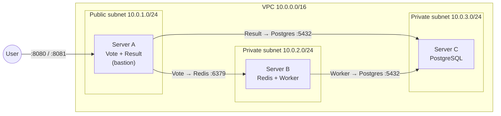

# Multi-Stack Voting App on AWS — Terraform & Ansible

A microservices voting app (cats 🐱 vs. dogs 🐶), containerized with Docker and deployed to AWS across three EC2 instances. The infrastructure is built with **Terraform**, the containers are deployed with **Ansible**.

> Project 1 of the Ironhack DevOps & Cloud Computing bootcamp.

## Architecture



| Service | Language | Server | Connects to |
|---|---|---|---|
| Vote | Python / Flask | A | Redis (B) |
| Result | Node.js | A | PostgreSQL (C) |
| Worker | .NET 8 | B | Redis (B), PostgreSQL (C) |
| Redis | — | B | — |
| PostgreSQL | — | C | — |

## Tech stack

- **Docker** — own images on DockerHub (`hserindik/vote`, `hserindik/result`, `hserindik/worker`)
- **Terraform** — VPC, subnets, Internet Gateway, NAT Gateway, route tables, security groups, EC2
- **Terraform remote state** — S3 bucket (versioned, private) + DynamoDB state locking
- **Ansible** — installs Docker and deploys all containers, idempotent playbooks

## Security

- Servers B and C are in **private subnets** without public IPs. They reach the internet only through the NAT Gateway.
- **Security groups** reference each other (least privilege):
  - A: ports 8080/8081 from the internet, SSH only from my IP
  - B: Redis (6379) and SSH only from A
  - C: PostgreSQL (5432) only from A and B, SSH only from A
- Ansible connects to B and C **through A** (bastion / ProxyCommand).

## Project structure

```text
.
├── vote/ result/ worker/      # App source code + Dockerfiles
├── docker-compose.yml         # Local test with my own images
├── build.sh                   # Build and push all images
├── terraform/
│   ├── backend-setup/         # S3 bucket + DynamoDB table (run once)
│   └── infra/                 # VPC, security groups, EC2, Ansible file generation
└── ansible/
    ├── site.yml               # Deploys everything in the right order
    ├── install_docker.yml
    ├── deploy_db.yml          # PostgreSQL on C (with volume)
    ├── deploy_backend.yml     # Redis + Worker on B
    └── deploy_frontend.yml    # Vote + Result on A
```

## How to build the images

```bash
docker login -u hserindik   # only once, use an access token as password
./build.sh                  # builds and pushes with tags: latest, v1
./build.sh v2               # builds and pushes with tags: latest, v2
```

## How to deploy

**Prerequisites:** AWS CLI, Terraform, Ansible (with `community.docker`), an SSH key at `~/.ssh/voting-app-key`.

```bash
# 1. Remote state (only once)
cd terraform/backend-setup && terraform init && terraform apply

# 2. Infrastructure — also generates the Ansible inventory and group_vars
cd ../infra
echo 'my_ip = "<YOUR_IP>/32"' > terraform.tfvars
terraform init && terraform apply

# 3. Deploy all containers
cd ../../ansible && ansible-playbook site.yml
```

Open `http://<frontend_public_ip>:8080` to vote and `http://<frontend_public_ip>:8081` to see the results.

**Clean up:** `cd terraform/infra && terraform destroy`

## Notes

- The `votes` table has no UNIQUE constraint on the voter ID, so one browser can vote many times. This makes demos easier.

## Next steps

- Application Load Balancer (`/vote`, `/result`) with a separate bastion host, all app servers in private subnets
- Move passwords to Ansible Vault (Docker warns about hard-coded passwords)
- Ansible dynamic inventory → AWS SSM Session Manager (no open SSH port)
- CI/CD with GitHub Actions
- Logging & monitoring with CloudWatch

## Credits

Based on the [Docker Samples example-voting-app](https://github.com/dockersamples/example-voting-app), adapted by Ironhack.
